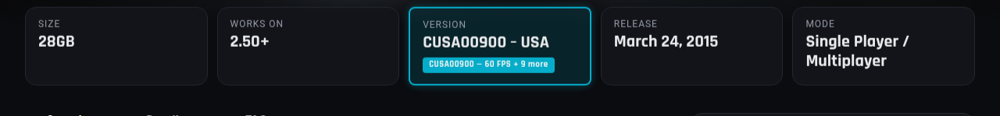

# SuperPSX Patch Checker

See at a glance which PS4 and PS5 games on SuperPSX have community patches (60 FPS, resolution, debug menu) from PS-Game-Patch.



## Install

```bash
git clone https://github.com/MehdiMamas/superpsx-patch-checker
```

Then open `chrome://extensions`, turn on **Developer mode**, click **Load unpacked** and pick the `superpsx-patch-checker` folder. No git? Download the zip from the [latest release](https://github.com/MehdiMamas/superpsx-patch-checker/releases/latest), extract it and load that folder instead.

## What it does

When you open a game page on [SuperPSX](https://www.superpsx.com), the extension reads the title ID (CUSA/PPSA) and checks it against a bundled index of the [PS-Game-Patch](https://github.com/illusionyy/PS-Game-Patch) patches. Nothing is sent over the network.

### Color coding

| Color | Meaning |
|-------|---------|
| **Cyan** | 60 FPS patch available |
| **Green** | Other patches available (resolution, debug menu, etc.) |
| **Red** | No patches found for this title ID |

The Version card and the Version line under Details get a badge with the title ID and a patch summary. On older pages that still list updates in a table, each update row is marked ✓ or ✗ depending on whether a patch targets that app version.

## How it works

- `patch_index.json` — Pre-built index of 376 title IDs and their patches, generated from the [PS-Game-Patch releases](https://github.com/illusionyy/PS-Game-Patch/releases)
- `content.js` — Content script that runs on SuperPSX pages, finds the title ID (Version card, Details list or older version tables), and applies highlights
- `background.js` — Service worker that loads the patch index and serves it to the content script
- `popup.html` / `popup.js` — Toolbar popup showing how many title IDs are indexed

## Updating the patch index

To update `patch_index.json` with newer patch data:

1. Download the latest `patch1.zip` from [PS-Game-Patch releases](https://github.com/illusionyy/PS-Game-Patch/releases)
2. Extract it
3. Run the index generator:

```bash
python3 generate_index.py /path/to/extracted/patches
```

## Contributing

Issues and pull requests are welcome: see [CONTRIBUTING.md](CONTRIBUTING.md).

## Credits and license

- Patches are made and maintained by the contributors of [illusionyy/PS-Game-Patch](https://github.com/illusionyy/PS-Game-Patch); `patch_index.json` only lists their patch names and versions. All credit for the patches goes to them.
- Not affiliated with SuperPSX or PS-Game-Patch.
- The extension code is under the [MIT License](LICENSE).

## Built with

- Chrome Extension Manifest V3
- Patch data from [illusionyy/PS-Game-Patch](https://github.com/illusionyy/PS-Game-Patch)
- Tested on [SuperPSX](https://www.superpsx.com)
